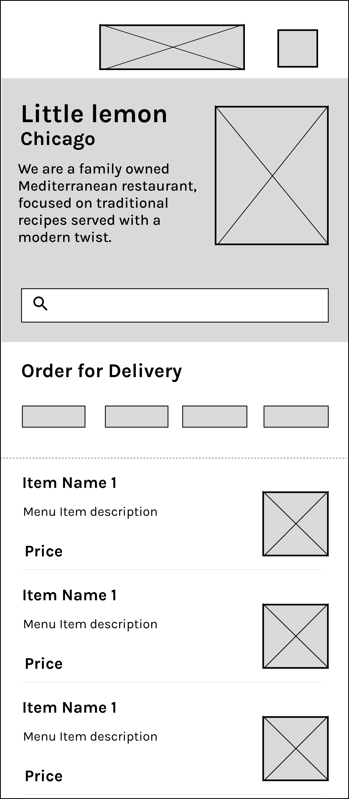

# Little Lemon - Meta Android Developer Capstone App

An Android application developed as the final Capstone project for the **Meta Android Developer Professional Certificate** on Coursera. **Little Lemon** is a restaurant mobile app featuring user onboarding, persistent profile management, offline-first menu caching via Room, remote network menu fetching via Ktor, live search and category filtering, and image loading powered by Coil Compose.

---

## 🎨 Wireframe & UI Design

### Wireframe Layout
The UI design strictly adheres to the official Coursera Little Lemon wireframe structure:



### Little Lemon Brand Palette

| Color Name                      | Hex Code  | Usage                         |
|:--------------------------------|:----------|:------------------------------|
| **Nandor (Primary Dark)**       | `#495E57` | Hero background, Header title |
| **GoldenCorn (Primary Yellow)** | `#F4CE14` | Buttons, Selected chips       |
| **DarkApricot (Secondary)**     | `#EE9972` | Accents & Highlights          |
| **PeachPuff (Secondary Light)** | `#FBDABB` | Surface & Warm elements       |
| **Sirocco (Neutral Gray)**      | `#71807B` | Subtitles & Inactive text     |
| **DarkCharcoal (Dark Neutral)** | `#333333` | Body text & Contrast text     |

---

## ✨ Key Features & User Flow

1. **Onboarding & Input Validation**:
   - Asks for First Name, Last Name, and Email Address.
   - Enforces real-time email format validation and checks for empty fields before allowing registration.
2. **Session Persistence**:
   - Saves session data using Android `DataStore` preferences. Automatically skips Onboarding on subsequent app launches.
3. **Interactive Home Screen**:
   - **Hero Banner**: Includes restaurant location ("Chicago"), tagline, hero image, and live search box.
   - **Live Search & Category Filtering**: Instantly filters menu items by text query (e.g., `"salad"`) and/or category chips (Starters, Mains, Desserts, Drinks).
4. **Offline-First Data Architecture**:
   - Fetches JSON menu data over network using **Ktor HTTP Client**.
   - Caches menu items in local **Room Database** (`MenuEntity`) for offline display.
5. **Dish Detail View**:
   - Navigates to dish detail view passing `MenuEntity` data and renders high-resolution dish artwork using **Coil Compose** (`AsyncImage`).
6. **Profile Management & Secure Logout**:
   - View stored personal details. Log out clears user session data and resets navigation stack.

---

## 🛠️ Tech Stack & Architecture

- **Language**: Kotlin
- **UI Framework**: Jetpack Compose with Material 3 (`androidx.compose.material3`)
- **Navigation**: Jetpack Navigation Compose (`androidx.navigation:navigation-compose`)
- **Networking**: Ktor Client (`io.ktor:ktor-client-android`, `io.ktor:ktor-serialization-kotlinx-json`)
- **Local Database**: Room Database (`androidx.room:room-runtime`, `androidx.room:room-compiler`)
- **Session Storage**: Jetpack DataStore Preferences (`androidx.datastore:datastore-preferences`)
- **Image Loading**: Coil Compose (`io.coil-kt:coil-compose`)
- **Serialization**: Kotlinx Serialization (`kotlinx.serialization`)

---

## 🚀 Getting Started & How to Run

### Prerequisites
- Android Studio Ladybug (2024.2.1+) or newer
- JDK 17+
- Android SDK API Level 34+ (Target SDK 34, Min SDK 26)

### Installation Steps

1. **Clone the Repository**:
   ```bash
   git clone https://github.com/felfeit/coursera-meta-android-app-capstone.git
   cd coursera-meta-android-app-capstone
   ```

2. **Open in Android Studio**:
   - Launch Android Studio and choose **Open an Existing Project**.
   - Select the cloned project folder.

3. **Sync Gradle & Build**:
   - Allow Android Studio to download dependencies and sync Gradle automatically.
   - Select the `app` run configuration and target an Android Emulator (API 26+) or a physical Android device.

4. **Run Application**:
   - Click the **Run** button (`Shift + F10`) or execute `./gradlew assembleDebug` via terminal.

---

## 📄 License
This project is completed as part of the Meta Android Developer Capstone coursework.
